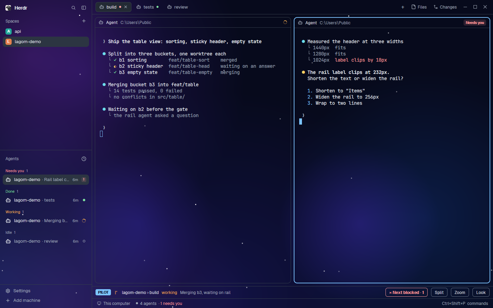
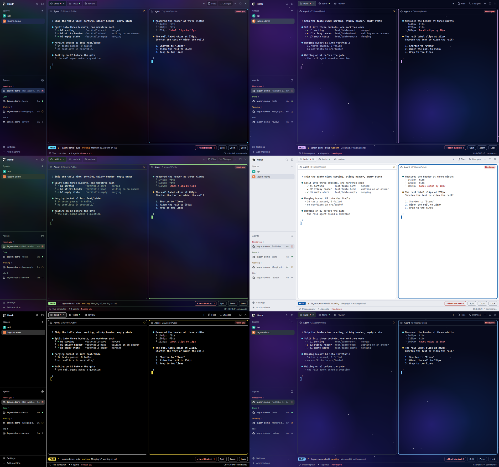
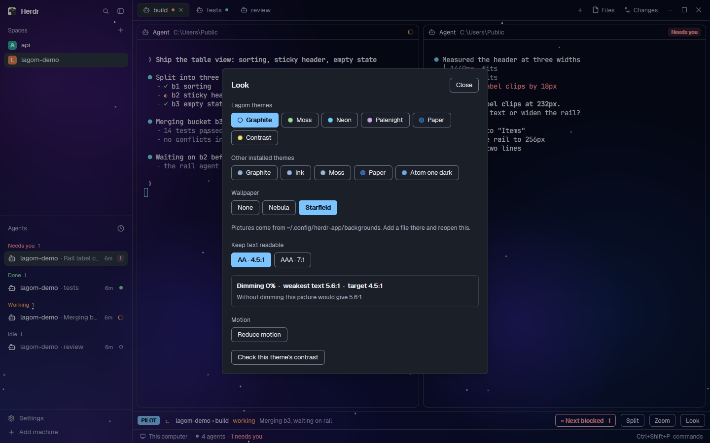
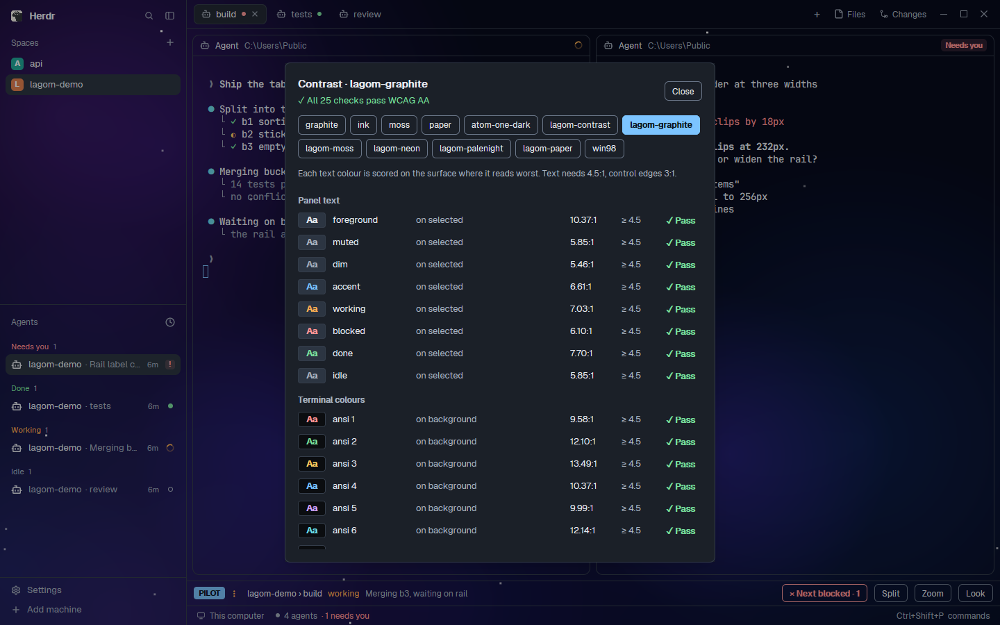

# Lagom

A layout for the [Herdr](https://herdr.dev) desktop app. *Lagom* is Swedish for "just the right amount".

- **Next move first.** A bar under the terminals names the one agent to watch and offers the next action as a button: `× Next blocked · 1`, `Split`, `Zoom`, `Look`.
- **Readable by measurement.** Six themes, every text colour at WCAG 2.2 AA or better on every surface. Put a wallpaper behind them and Lagom dims it by exactly as much as the text needs, and tells you the ratio.
- **A contrast checker.** Scores any installed theme, not only these.





| Look dialog | Contrast dialog |
|---|---|
|  |  |

The agents in these pictures are stand-ins made by `tools/demo.sh`: plain shells that print a few lines and report a status.

## Install

Ask your agent in Herdr to add `github.com/hasuwini77/herdr-lagom`, or copy by hand into `~/.config/herdr-app/`:

```sh
cp -r layouts mods themes backgrounds ~/.config/herdr-app/
herdr-app do layout.switch --name lagom
```

The layout needs the `themes/` folder too: without it Herdr refuses the layout. Your own layout stays as it was; `cmd-shift-l` on macOS (`ctrl-shift-l` on Windows and Linux) cycles back to it.

Lagom runs one program, and only when you pick a wallpaper of your own: Python, to measure how bright the picture is. It writes one file: the Lagom layout, to store the theme and wallpaper you picked.

## Keys

None are bound by default. Add any of these to `keys.json`:

`lagom.look` · `lagom.next-blocked` · `lagom.theme-next` · `lagom.wallpaper-next`

## What is here

| Path | What |
|---|---|
| `layouts/lagom.json` | the layout |
| `mods/lagom/` | the bar and the Look dialog |
| `mods/contrast/` | the contrast checker |
| `themes/lagom-*.json` | graphite, neon, palenight, moss, paper, contrast |
| `backgrounds/` | nebula, starfield |
| `tools/build-themes.py` | writes the themes and fails if any text colour is under 4.5:1 |
| `tools/demo.sh` | fills the window with stand-in agents for a screenshot |
| `RECIPE.md` | the brief to build Lagom from scratch |

Seen working on the Herdr App 0.1.15 Windows build with terminals in WSL, and installed on an empty home on the 0.1.14 Linux build. On macOS (Herdr App 0.1.18, Apple silicon) the bar, Next blocked and the Look dialog work.

MIT. Made by Edwin.
