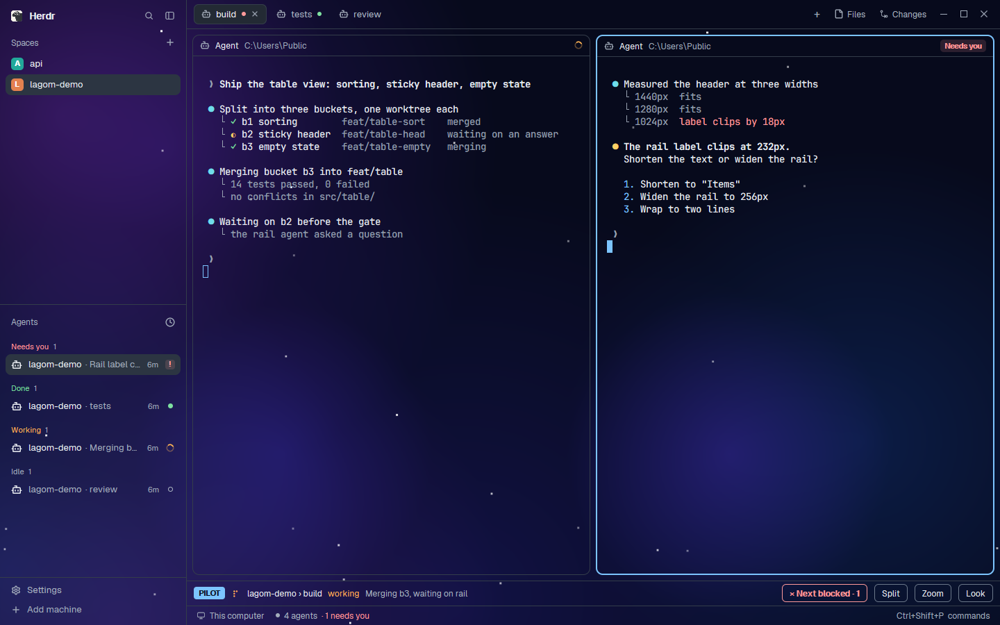

# Lagom

A calm Herdr window that always shows your next move. A slim bar under the terminals names the one agent to watch (the pilot) and offers the next action as a labelled button. A Look dialog switches between six themes and two wallpapers, and dims the wallpaper by exactly as much as the text needs to stay readable (WCAG 2.2 AA or AAA). A Contrast dialog scores any installed theme.

## What you see

Left to right, top to bottom:

- **Sidebar**, 268px wide, `chrome` colour: Herdr's brand row (46px), the spaces list and the agents list sharing the height equally (each at least 90px), and Herdr's footer (69px).
- **Tab bar**, 42px, the window drags from it. There is no title bar.
- **Terminals**, on the `canvas` colour with 8px around and between them. Each pane is a card: 10px corners, a 1px `border` edge, a 2px `accent` edge when focused, and a 30px header that is always shown. Terminal text sits 14px from the sides and 12px from top and bottom.
- **Side panel** (files, changes), 368px, hidden until asked for.
- **Lagom bar**, 36px, `chrome` colour, 1px `border` line on top, 12px text:
  - a `PILOT` pill (`accent` fill, `accent_foreground` text, 10.5px bold, 18px high, 4px corners);
  - the pilot agent: its status mark, `space › tab` (at most 240px), its status in the status colour, then its title in `muted`, cut with an ellipsis;
  - on the right, buttons 26px high with 6px corners and a 1px `input` edge: `× Next blocked · N` (in the `blocked` colour, only while an agent is blocked), `Split`, `Zoom` (both only while a pane is focused), `Look`.
- **Status bar**, 28px, Herdr's own.

Six themes, each a full set of panel and terminal colours:

| Theme | Background | Accent | Weakest panel text |
|---|---|---|---|
| `lagom-graphite` (default) | `#0b0d10` | `#7cc4ff` | 5.46:1 |
| `lagom-neon` | `#05080f` | `#5fd7ff` | 5.09:1 |
| `lagom-palenight` | `#292d3e` | `#d2a6ef` | 4.68:1 |
| `lagom-moss` | `#0a0f0c` | `#9be28a` | 5.50:1 |
| `lagom-paper` (light) | `#ffffff` | `#0a5aa8` | 4.83:1 |
| `lagom-contrast` | `#000000` | `#ffe14a` | 6.32:1 |

Two wallpapers, both dark: `nebula.png` (1920×1080) and `starfield.png` (2880×1620).

## How it behaves

- **The pilot** is the first agent pinned in Herdr; with none pinned, the working agent that changed last; with none working, whoever changed last. Clicking it focuses that agent.
- **Status**, as a mark and a word in the theme's status colour: working `◐` "working 12m" (minutes since the tab started working), blocked `×` "needs you", done `✓` "done", idle `○` "idle". While working, the mark is a ten-frame spinner at 90ms a frame.
- **Next blocked** focuses the agent that has waited longest and shows how many wait.
- **No space open:** the bar says so and shows `+ New space`. **A space but no agent:** it points at the `+` in the tab bar.
- **Look** opens a 540px dialog:
  - *Lagom themes* and *Other installed themes*: chips with the theme's accent as a dot. High contrast is listed last.
  - *Wallpaper*: `None` and every picture in `backgrounds/`.
  - *Keep text readable*: `AA · 4.5:1` or `AAA · 7:1`.
  - A readout, for example `Dimming 26% · weakest text 4.5:1 · target 4.5:1` and `Without dimming this picture would give 3.8:1.` When the theme's own text cannot reach the target it says `Target out of reach.` and why.
  - *Motion*: `Reduce motion` stops the spinner.
  - `Check this theme's contrast` opens the Contrast dialog.
- **Wallpaper dimming.** The picture shows through the sidebar, the bars and the terminals. Lagom covers it with the theme's own colours at the lowest strength (in 1% steps) at which every text colour still reaches the target over the picture's brightest 1% (darkest 1% under a light theme).
- **Contrast** (620px wide, 80% of the window high) lists one row per check: a sample, the colour's name, the surface where it reads worst, the ratio, the bar and `✓ Pass` or `× Fail`. Panel text and terminal colours 1 to 15 need 4.5:1, control edges 3:1. Chips at the top score any other installed theme without switching to it.
- **Keys** (none bound by default): `lagom.look`, `lagom.next-blocked`, `lagom.theme-next`, `lagom.wallpaper-next`.

## Built from

Copy `layouts/`, `mods/`, `themes/` and `backgrounds/` into the Herdr home.

- **Layout** `layouts/lagom.json`: root `row`, `titlebar: "none"`, `traffic_lights: [12, 16]`, `terminal_padding: [14, 12]`, a 1px `border` divider, `theme: "lagom-graphite"`, `background: "canvas"`.
  - `sidebar` column (268px, min 44, max 480, `chrome`, not resizable): `workspace-chrome` (46px, drags the window), a column of `spaces` and `agents` (weight 1 each, min 90), `workspace-chrome` with `props: { footer: true }` (69px).
  - `work` column: `tabs` (42px, drags the window); `work-body` row (padding 8, gap 8) holding `main` (`tab: "active"`, pane header mod `pane`, `reveal: "always"`, height 30, radius 10, gap 8, `lone: true`) and a hidden `panel` column (368px, min 280, max 900) with a stack of `files` and `changes`; `lagom-bar` (mod `lagom`, `props: { role: "bar" }`, 36px); `status` (`workspace-status`, 28px).
- **Mod `lagom`**, one mod with two roles: `props.role` `"bar"` (in the layout) and `"look"` (opened with `openOverlay`, `kind: "dialog"`, width 540). `mod.json` is `{ "place": "none", "title": "Lagom" }`.
  - `herdr` functions: `agents`, `spaces`, `focused`, `theme`, `themes`, `settings`, `layout`, `shared`, `setShared`, `props`, `run`, `openOverlay`, `closeOverlay`, `nextCommand`, `appHome`, `readTextFile`, `writeTextFile`, `exec`.
  - Commands it runs: `agent.focus`, `pane.split {direction: "right"}`, `pane.zoom`, `space.new`, `mod.open {name: "contrast"}`.
  - State: `shared("lagom.look")` = `{ theme, image, measure, target }`, `shared("lagom.still")` for reduced motion.
  - With a wallpaper at dimming `a`, it writes into the shown layout file: `background: { image, fit: "cover" }`; `colors.chrome` and `colors.background` as the theme's colours plus a two-digit alpha; the same for `work-body`'s `background` from `canvas`; `terminal_opacity` = `1 - sqrt(1 - a)` rounded to three places; the pane `background` as `#00000000`. Without one it removes them all again.
  - It reads the names in `backgrounds/` (skipping names that start with `_` or contain `.preview.`).
  - `wcag.js`: contrast maths and the dimming search. `measure.py`: prints a picture's darkest and brightest 1% as JSON (Pillow, then ImageMagick, then a plain 8-bit PNG reader).
  - It runs one program: `python3` (then `python`) on `measure.py`, only for a picture that is not one of the two shipped ones, which are measured ahead.
- **Mod `contrast`**: a dialog (`mod.json` `overlay: { kind: "dialog", width: 620, height: 0.8 }`). Reads `theme`, `themes`, `settings`; nothing else.
- **Themes** `themes/lagom-*.json`, written by `tools/build-themes.py`, which fails if any text colour is under 4.5:1 on any surface.
- **Art**: `backgrounds/nebula.png` and `backgrounds/starfield.png`, both generated for Lagom.

## Watch out

- The layout names the theme `lagom-graphite`. Without `themes/lagom-graphite.json` in the Herdr home, Herdr refuses the layout: `layouts/lagom.json was not applied: theme "lagom-graphite" is not one of …`. Copy `themes/` along with `layouts/` and `mods/`; `backgrounds/` is optional.
- The layout's theme must be one name. `app.theme` fills only the light or the dark half of a `{ light, dark }` theme, so a dark pick is invisible in a light appearance. Lagom adopts whichever half is on screen and writes that single name.
- Once a wallpaper is on, `theme()` returns the translucent colours Lagom wrote. Take a theme's real colours from `themes()` by name.
- Numbers come back as 32-bit floats (`0.163` returns as `0.16300000250339508`). Compare with a tolerance, or the layout is rewritten on every render.
- Write the layout file once per change and wait 1.5s for the reload before comparing again. Touch only a layout that contains the `lagom-bar` block.
- The dimming search runs on every render. Keep its answer and work out each text colour's luminance once. Under the light theme with a dark picture it walks 94 steps; done naively the render is cut off and the bar shows "This view could not be re-rendered".
- Windows has no `python3`. A picture that cannot be measured gets a fixed 75% dimming and the dialog says so.
- The measurement ignores the brightest 1%, so a few single stars can sit behind text.
- "done" exists only for an agent that finished while nobody looked; it turns idle once seen.
- `Split`, `Zoom` and `Look` have no keys until the person binds them.
- Seen working on the Herdr App 0.1.15 Windows build with terminals in WSL. `herdr-app check` passes on the Linux build. macOS is untested.

## Done when

- `herdr-app check mods/lagom` and `herdr-app check mods/contrast` both print `check passed`.
- `layout.switch {name: "lagom"}` shows the bar with the `PILOT` pill, and `herdr-app status` lists no errors.
- With one working and one blocked agent, the bar names the working one and shows `× Next blocked · 1`; clicking it focuses the blocked agent.
- `lagom.theme-next` six times walks all six themes and ends where it started; the bar still draws under `lagom-paper`.
- Under `lagom-graphite`, picking Starfield reads `Dimming 0% · weakest text 5.6:1 · target 4.5:1`; picking Nebula reads `Dimming 26% · weakest text 4.5:1 · target 4.5:1`.
- Picking `None` leaves no `colors`, `terminal_opacity` or background image in the layout file.
- Contrast on `lagom-graphite` reads `✓ All 25 checks pass WCAG AA`.
- `python3 tools/build-themes.py themes` prints `ok` for all six themes.
